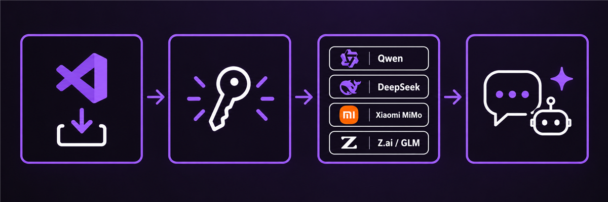

# NaN Builders for VS Code

[](https://github.com/svg153/nan-vscode/actions/workflows/ci.yml)
[](https://github.com/svg153/nan-vscode/actions/workflows/release.yml)
[](https://marketplace.visualstudio.com/items?itemName=svg153.nan-builders-vscode)

Use [NaN Builders](https://nan.builders/) models in VS Code Chat and Agent mode through the native `LanguageModelChatProvider` API.

> **Status:** early MVP and community-maintained. This extension is not an official NaN Builders product unless NaN Builders explicitly adopts or publishes it.



## What works

- Native `languageModelChatProviders` integration for VS Code Chat and Agent mode.
- API key stored in VS Code `SecretStorage`.
- API-key validation and model discovery through `GET https://api.nan.builders/v1/models`.
- The model picker follows the API-key-filtered list returned by NaN, so premium-only models appear only when the key can actually call them.
- Streaming chat through `POST https://api.nan.builders/v1/chat/completions`.
- VS Code tool definitions mapped to OpenAI-compatible function tools.
- Streamed tool calls mapped back to VS Code so supported models can run in Agent mode.
- Image inputs for catalogued vision-capable models.
- Opt-in inline ghost-text completions through the legacy `POST /v1/completions` endpoint when `nanBuilders.completionModel` is set ([issue #8](https://github.com/svg153/nan-vscode/issues/8)).
- Local status-bar usage when the API returns OpenAI-compatible streaming usage metadata.
- Account-wide credit usage in the status bar via `GET /v1/usage` when an API key is configured, with local-session usage as fallback.
- Conservative handling of newly discovered model IDs that are not yet in the local metadata catalog.
- Per-model reasoning effort: choose a level with **NaN Builders: Set Model Reasoning Effort**, send per-request levels through `modelOptions`, or leave everything on `auto`, which uses a documented default per model.
- Opt-in `nanBuilders.discoveryMode: auto` for Copilot-style auto-discovery from trusted OpenAI-compatible endpoints: every non-chat-filtered ID returned by `GET /models` appears in the picker with endpoint-declared capabilities ([issue #100](https://github.com/svg153/nan-vscode/issues/100)).
- Remote-workspace support: the provider prefers the workspace extension host and falls back to the local UI host.

## Install

### From the Marketplace

Search for **NaN Builders for VS Code** in the Extensions view, or run:

```bash
code --install-extension svg153.nan-builders-vscode
```

The listing is community-maintained under the `svg153` publisher and is not an official NaN Builders product.

Pre-release builds are published to the Marketplace pre-release channel on every
merge that cuts a release. To try them, open the extension in the Extensions
view, choose **Switch to Pre-Release Version**, and update normally; switch back
to **Release Version** at any time. Stable versions are promoted manually once a
pre-release has been validated, so a pre-release is ahead of the latest stable
on purpose.

### From a release VSIX

1. Download the latest `.vsix` from [GitHub Releases](https://github.com/svg153/nan-vscode/releases).
2. In VS Code run **Extensions: Install from VSIX...**.
3. Reload the window if VS Code asks.

### From source

```bash
npm ci
npm run check
npm run package
```

Install the generated `nan-builders-vscode-*.vsix` with **Extensions: Install from VSIX...**. For interactive development, open the repository in VS Code and press `F5` to launch an Extension Development Host.

## Configure

1. Open the Command Palette.
2. Run **NaN Builders: Manage Provider**.
3. Choose **Set or replace API key** and paste a NaN API key (with profiles configured, this sets the active profile's key; see [API key profiles](#api-key-profiles)).
4. Choose **Validate API key and refresh models**.
5. In Chat or Agent mode, select a model under the **NaN Builders** provider.

On recent VS Code builds the provider also shows its logo in the chat model picker and exposes native configuration: open **Manage Models**, expand **NaN Builders**, and set **API Key** (stored securely by VS Code) and **API Base URL** directly there. Values entered in Manage Models take precedence for chat and model discovery and the key is adopted into the extension's own SecretStorage; **NaN Builders: Manage Provider** keeps working on older VS Code versions and for the remaining commands.

The model picker is intentionally limited to IDs returned by the key's `/v1/models` response. Run **NaN Builders: Refresh Models** after access changes. Provider extensions can also be found with the VS Code Marketplace filter:

```text
@tag:language-models
```

Available settings:

| Setting | Default | Purpose |
| --- | --- | --- |
| `nanBuilders.apiBaseUrl` | `https://api.nan.builders/v1` | OpenAI-compatible API base URL. Change only for development or trusted compatible servers. |
| `nanBuilders.modelCacheSeconds` | `300` | Model discovery cache duration. |
| `nanBuilders.showStatusBar` | `true` | Show usage in the status bar: plan-credit usage % when an API key is configured, otherwise local session usage. |
| `nanBuilders.includeUnknownModels` | `false` | Expose unknown IDs without tool or vision metadata. |
| `nanBuilders.defaultReasoningEffort` | `auto` | Fallback reasoning level for models that expose adjustable effort. `auto` uses each model's documented default (medium when supported, otherwise the central documented level); explicit levels act as the global fallback. |
| `nanBuilders.reasoningEffortByModel` | `{}` | Per-model reasoning overrides set by **NaN Builders: Set Model Reasoning Effort** (for example `"glm-5.3-flash": "high"`). Overrides win over the global setting; removing an entry resets that model to `auto`. A `profile::model` key (for example `"work::glm-5.3-flash"`) instead assigns that model to a profile; its value is the effort for that model on that profile, and `auto` keeps the routing without overriding the effort. |
| `nanBuilders.profiles` | `[]` | Profile IDs managed by **NaN Builders: Manage Provider**. Only IDs are stored here; each profile's API key lives in VS Code SecretStorage under `nanBuilders.profileKey.<profileId>`. Empty keeps the single shared key working, see [API key profiles](#api-key-profiles). |
| `nanBuilders.activeProfile` | `""` | Profile whose API key serves every model without a `profile::model` assignment. Empty selects the first configured profile. Ignored when no profiles are configured. |
| `nanBuilders.discoveryMode` | `"curated"` | `auto` lists every chat ID returned by `GET /models` from a trusted custom endpoint, except obvious non-chat names (embeddings, rerank, speech, transcription, moderation/guard, image/video generation, minimax-only endpoints). Endpoint-declared capability fields take precedence; models without metadata get conservative defaults. In `curated` mode, if `GET /models` fails or returns no chat IDs, the picker falls back to the static catalog marked "not live-verified". |
| `nanBuilders.completionModel` | `""` | Model ID for opt-in inline ghost-text completions; empty disables the feature and no completion request is sent. |
| `nanBuilders.maxParallelRequests` | `7` | Requests allowed in flight per API key, shared by chat and inline completions. NaN serves 7 per key and answers more with HTTP 429, so extra requests wait in a FIFO queue. Values above 7 are capped at the gateway limit. |

## API key profiles

When you hold more than one NaN API key (for example a work key and a personal key), profiles let one model use one key and everything else use another.

**Set up a profile:**

1. Run **NaN Builders: Manage Provider** and choose **Manage profiles** → **Add profile**.
2. Enter a profile ID (`work`, `team.eu-1`, up to 32 characters) and its API key. The ID goes to `nanBuilders.profiles`; the key goes to VS Code SecretStorage under `nanBuilders.profileKey.<profileId>` and is never written to settings.
3. Add the second profile the same way.

**Route a model to a profile:** **NaN Builders: Manage Provider** → **Assign a model to a profile**, pick the profile, then the model. This writes a `profile::model` entry into `nanBuilders.reasoningEffortByModel` (for example `"work::glm-5.3": "auto"`). The assignment can also carry that model's reasoning effort: pick the level, or `auto` for routing only. **Remove a model assignment** drops the entry, so the model falls back to the active profile.

**Everything else** uses the profile marked active: **Manage profiles**, pick a profile, **Use as active profile** (stored in `nanBuilders.activeProfile`; empty means the first configured profile).

Key resolution per request, first match wins:

1. The native **Manage Models → API Key** value, when VS Code supplies one.
2. The `profile::model` assignment for that model.
3. The active profile.
4. The legacy shared key `nanBuilders.apiKey`, used only when no profile is configured.

Notes:

- **A profile without a key fails loudly.** The request stops before any gateway call with an error naming the profile, so a typo is not mistaken for an invalid key. Inline completions never raise notifications, so for them a missing profile key only yields no ghost text and one diagnostic line.
- **Deleting or renaming a profile keeps things consistent.** Delete removes the profile ID, its SecretStorage key, and every `profile::model` assignment for it, so no later request can resolve to it. Rename moves the key and the assignments to the new ID.
- **Per-key concurrency still applies.** Each request carries the key it resolved to, and `nanBuilders.maxParallelRequests` (default `7`) caps requests per key, so two profiles may run up to seven requests each.
- **Own accounts only, and no automatic rotation.** Profile keys must be accounts you own and pay for. NaN's terms describe each member's key as personal and non-transferable, forbid sharing or transferring a key, and forbid attempting to exceed the published limits; the limits are per key (60 requests per minute and 7 concurrent requests on the base plan) and credits do not lift them. The extension therefore never rotates keys on its own: a throttled or exhausted key reports its own error, and moving to another key is a manual choice (switch the active profile, or assign the model to another profile). Do not configure a key you do not own, and do not expect several profiles to add up to one larger allowance (see [docs/DECISIONS.md](docs/DECISIONS.md)).
- **No profiles, no change.** With `nanBuilders.profiles` empty, the extension behaves exactly as before and the single `nanBuilders.apiKey` keeps working; no migration is required.
- **One vendor, several providers.** Profiles are read from this extension's settings and SecretStorage. If another extension registers the same `nan-builders` vendor, VS Code can list duplicate model entries and the two extensions do not share profile configuration (see [docs/DECISIONS.md](docs/DECISIONS.md)).

## Diagnostics

Two read-only commands help when the model picker is empty or a request fails. Neither sends a chat request, and neither prints an API key, token, or `Authorization` header.

- **NaN Builders: Test Connection** runs model discovery silently and reports either `OK — N model(s) reachable (id, ...)` or an actionable warning naming the base URL, the HTTP status, the sanitized gateway error, and the command to run next.
- **NaN Builders: Show Diagnostics** opens a Markdown report with the VS Code and extension versions, the effective base URL, the discovery mode, the models this VS Code host exposes through `vscode.lm.selectChatModels` (ID and `maxInputTokens`), the number of configured keys/profiles (count only; values are never read), the configured profile IDs with whether each has a key (`configured`/`missing`) and which model is routed to which profile, and the locally tracked model IDs. When the report cannot be opened as a document, the same text is written to the output channel.

Both commands print a display-only form of the base URL: embedded credentials (`user:password@`) are removed and the values of credential-bearing query or fragment parameters (`api_key`, `key`, `token`, and similar) are replaced with `******`, so a shared report never leaks a secret. An unparseable base URL is reported as `(unparseable base URL)` instead of being echoed.

## Reasoning effort per model

Models differ in which reasoning levels the API documents for them. Resolution happens per request, in this order:

1. `modelOptions.reasoning_effort` supplied with the request.
2. `nanBuilders.reasoningEffortByModel[model]` (set through the picker command).
3. `nanBuilders.defaultReasoningEffort`, unless it is `auto`.
4. The model's documented default: `medium` when the model supports it, otherwise the central documented level.

Whatever level is chosen is remapped to the closest documented level for that model (ties move upward), so selecting an unsupported deep-thinking level on a shallow model never sends a value the API rejects. The ladders are curated from the "Controlling reasoning" table at <https://nan.builders/docs/models> (checked 2026-11-17): `/v1/models` does not publish per-model effort levels, so the table must be re-checked when the docs change. Model-specific quirks are stated in each model description: GLM always reasons (`none` is applied as `minimal`); Gemma 4 and Qwen 3.6 treat both `none` and `minimal` as off, with levels capping the reasoning phase between 2,048 and 32,768 tokens; MiMo documents only `low`–`max` and counts reasoning tokens inside `max_tokens`; `deepseek-v4-flash` and `qwen3.8-flash` treat effort values as hints rather than caps. `qwen4-max` documents `none` as off plus `minimal`–`max`, so it uses the full ladder, while `hy4-flash` documents only that it reasons by default and that `none` turns it off, so like `kimi-k3.1-pro` and `deepseek-v4-pro` it is treated as model-managed (`[]`).

Run **NaN Builders: Set Model Reasoning Effort** from the Command Palette, pick a model, then pick a level (or reset it to `auto`). The current level is shown in the model tooltip and in the selection UI description.

When `nanBuilders.apiBaseUrl` uses non-loopback `http:`, the extension asks before sending the stored API key. The decision is remembered for that endpoint until the extension session ends and covers model discovery, chat, account usage, and inline completions. A declined endpoint stays blocked without repeating the prompt; changing the endpoint clears declined decisions. Canceling prevents the request; HTTPS and loopback HTTP endpoints do not prompt.

### Recipe: custom OpenAI-compatible server with auto-discovery

To point the extension at a trusted OpenAI-compatible server (LM Studio, vLLM, Ollama's OpenAI endpoint, a corporate gateway) and pick its models directly, like the Copilot custom-endpoint experience:

1. Set the endpoint and restart-free refresh:

   ```json
   "nanBuilders.apiBaseUrl": "https://my-server.example.com/v1/",
   "nanBuilders.discoveryMode": "auto"
   ```

2. Run **NaN Builders: Manage Provider** to store the server's API key (any bearer token the server expects) and validate it; the picker then lists every chat ID returned by `GET /models`, minus obvious non-chat endpoints.
3. Trigger **NaN Builders: Refresh Models** after adding or removing models on the server; results are cached for `nanBuilders.modelCacheSeconds`.

Notes: in `auto` mode the picker reflects the live endpoint only (no NaN catalog fallback), capability fields declared by the server (`is_chat`, `model_type`, context/output limits) take precedence over conservative defaults, and `http:` (non-loopback) endpoints require the one-time consent prompt before the key is sent. Set `discoveryMode` back to `curated` to restore the NaN Builders Marketplace experience.

## Remote workspaces

The provider prefers the workspace extension host when using WSL, SSH, or a Dev Container. This keeps the model provider on the same host as the Chat/Agent session and avoids a known VS Code routing problem where Auto can replace an explicitly selected remote-provider model. In a remote workspace, install the extension and enter the API key in that remote host's SecretStorage.

For a local workspace, it continues to run locally. To force a published installation to the remote host while testing, use:

```json
"remote.extensionKind": {
  "svg153.nan-builders-vscode": ["workspace"]
}
```

## Agent mode and model metadata

NaN chat models with compatible function tool calling are marked as supporting tools and appear in Agent model selection. The extension maps VS Code tools to OpenAI-compatible function tools, handles streamed tool calls, and maps tool names back to the original VS Code tool names.

Only model IDs returned by `/v1/models` are exposed. Known non-chat endpoints are removed. Unknown IDs are hidden by default so an embedding, image, or audio endpoint is not accidentally advertised as a chat model. Set `nanBuilders.includeUnknownModels` to `true` to expose unknown IDs conservatively while local metadata catches up.

VS Code needs context-window, output-budget, image, and tool-calling metadata, while `/v1/models` is the authorization and discovery source. The extension therefore keeps a small local capability catalog and never exposes a catalogued model unless the API key can access it. Refresh the catalog when NaN changes model capabilities. NaN's larger models (`kimi-k3.1-pro`, `qwen3.8-max`, `qwen4-max`, `deepseek-v4-pro`, `hy4`, `glm5.3`) are appended with a `(larger model)` suffix in the picker because they bill more credits per token; their picker tooltip also states that they cost more per token than the flash models, while every other entry states that it draws from the account-wide credit pool. `clef` is a decision endpoint on `POST /v1/systemone` and is never offered as a chat model.

## Usage and limitations

With an API key configured, the status bar shows how much of the plan's credit allowance you have used this period (`$(graph) NaN NN%`), read from `GET /v1/usage`. While `credits.frozen` is true it reads `$(warning) NaN frozen` instead, because credit-billed requests are being refused and the percentage is no longer the actionable information. **NaN Builders: Show Usage** shows the credit allowance, per-model credit usage for the current month, the local session history, provider management, and the NaN dashboard. Without an API key, the status bar and command fall back to local session usage.

Account-wide usage details:

- Requests are authenticated with the stored API key, never browser cookies or `nan-cli` sessions.
- The window is the current calendar month (UTC), clamped client-side to the API's maximum of 90 days, with at most 500 rows per page and up to 3 pages merged.
- NaN bills metered models from one credits pool (7,000 credits on Inference, 20,000 on Premium, then optional credit packs), so per-model percentages are each model's share of that single allowance. Unmetered models (qwen3.6, gemma4, embeddings, rerank, audio, image) show **Does not draw credits**; a model with no billed credits in the window shows a note instead of a fabricated percentage.
- The headline percentage is the plan-credit usage for the current billing period, never a sum across models.
- Cached input tokens reported by NaN are shown for the window and for each model; they are already part of the prompt count, so they are never added to the token total.
- While `credits.frozen` is true the subscription is inactive and credit-billed requests are refused, so the status bar switches to `$(warning) NaN frozen` and the tooltip and QuickPick flag the plan credits as frozen instead of implying the allowance is spendable.
- `credits.pack_expires_at` is rendered as a readable date with the distance in days ("expires 2026-06-01 (in 12 days)", "expires today", "expired on …") instead of a raw timestamp.
- The QuickPick shows a **Window credits (calendar month)** row: the sum of the per-model credits rows, rounded to one decimal. NaN rounds each row and each model independently, so this figure can differ from the billing-period `used` total by tenths; it is labelled as an approximation and never replaces the headline percentage.
- **Show Usage** ends with an **Open** section that deep-links to the NaN Cloud pages this feature depends on: `#settings-api-keys` for key management, `#settings-billing` for the plan allowance, credit packs and invoices, `/tokens` for the credits-per-1M-token price of each model, and the model catalogue at `nan.builders/docs/models`. Both `#settings-*` routes were checked against the console bundle's route table before being shipped.
- A `402 insufficient_balance` from any endpoint appends which credit reason applies (allowance exhausted, frozen credits, or no active pack) and points at **NaN Builders: Show Usage**, instead of surfacing a bare status code.
- Credits are billed and reported from 2026-11-10 onward, cached input tokens from 2026-11-11, and `api_requests` counts from 2026-09-02; earlier dates report 0.
- Usage refreshes are throttled client-side (60s between automatic refreshes, plus a 30 requests/minute limiter). A 429 response surfaces its `Retry-After` hint.
- Errors never clear the last good snapshot; they are reported in the tooltip and command output.
- The shipped account-usage decision and its remaining deferrals are recorded in [Implementation decisions](https://github.com/svg153/nan-vscode/blob/main/docs/DECISIONS.md); the manual checks live in the [Validation checklist](https://github.com/svg153/nan-vscode/blob/main/docs/VALIDATION.md).

Local usage remains available regardless of the API: **NaN Builders: Show Usage** also shows per-model daily aggregates (UTC days) retained locally for 30 days (up to 1,000 model/day records); use **Clear local history** in that dialog to remove them. Only counts and model IDs are stored in VS Code extension storage—never prompts, completions, API keys, or request payloads.

VS Code does not expose a documented usage-reporting callback for third-party chat providers, so local counts only cover turns where the API returned OpenAI-compatible streaming usage metadata; see [issue #7](https://github.com/svg153/nan-vscode/issues/7).

Long conversations are trimmed before they are sent. The extension estimates the input with the same counter that backs `provideTokenCount`, and when that estimate exceeds the model's input budget (`min(context window - max output, 90% of the context window)`) it drops whole units from the middle of the conversation outward. A unit is an assistant message together with its `tool_calls` and every tool result that answers them, so a request never carries an orphaned tool result. The first unit, any system framing, and the unit being answered are never trimmed, and a conversation that already fits is sent byte for byte unchanged. Each trim shows one warning per conversation and, with `nanBuilders.diagnostics.enabled`, writes one counts-only `chat.history.trimmed` line with the units discarded and the estimated tokens before and after; message content is never logged. Summarizing the dropped turns is not implemented.

Inline ghost-text completions are opt-in and off by default. Set `nanBuilders.completionModel` to a model ID returned by `/v1/models` and the extension registers an `InlineCompletionItemProvider` for file-scheme documents. Each suggestion is one `POST {apiBaseUrl}/completions` request carrying only the last 4,000 characters before the cursor, capped at 64 completion tokens and 1,000 suggestion characters. The provider waits for a fixed 150 ms quiet period after the latest trigger, cancels pending or in-flight work when another trigger arrives, and never returns stale text; HTTP errors, network failures, and empty or malformed responses are dropped. Quality depends on the chosen model, and while enabled each pause while typing can send an extra billed request that local usage history does not count yet (see [issue #7](https://github.com/svg153/nan-vscode/issues/7)).

Requests are queued per API key. NaN serves at most 7 concurrent requests per key and answers the next one with HTTP 429, and agent turns can start several tool calls while an inline completion is already in flight. The extension keeps one first-in-first-out queue per API key, shared by chat and inline completions, so no more than `nanBuilders.maxParallelRequests` requests (default 7, the gateway limit) are in flight at once; a request counts as in flight until its response stream finishes, not just until headers arrive. Waiting requests start in the order they arrived, a request VS Code cancels while it is still queued is dropped without being sent, and a failed, timed-out, or canceled request always frees its slot for the next one, so a hung request cannot stall the queue. A 429 that still arrives is reported through the normal error mapping with its `Retry-After` hint; the extension never retries automatically. Below the limit nothing waits, and each API key keeps its own queue so a second key does not share slots.

## Architecture

```text
VS Code Chat / Agent
        |
        v
LanguageModelChatProvider
        |
        +--> GET  /v1/models
        |
        +--> GET  /v1/usage
        |
        +--> POST /v1/chat/completions
                 |  SSE text
                 |  tool calls
                 +  usage
```

No alternate chat webview is created; the provider uses the built-in VS Code Chat and Agent UX.

## Troubleshooting

- **No models appear:** validate the key, then refresh models. Check that the key can call `/v1/models`.
- **A model is missing:** the API key does not currently return that model, or it is a known non-chat endpoint.
- **A request stops without text:** NaN may have hit a reasoning-only truncation; try a shorter prompt or a model with adjustable reasoning.
- **Earlier turns seem to be missing:** the conversation exceeded the model's input budget and the middle turns were trimmed to fit. Start a new chat if the model needs those earlier details; enable `nanBuilders.diagnostics.enabled` to see how many units were dropped and the estimated tokens before and after.
- **Remote or WSL window:** the provider prefers the workspace extension host; install the extension and configure the key in that remote host's SecretStorage.
- **Key safety:** use **Clear API key** from the management command to remove it from SecretStorage.

## Security

- API keys are stored with VS Code `SecretStorage`, not in settings JSON or the repository.
- The extension does not log API keys.
- `nanBuilders.apiBaseUrl` is machine-scoped so a workspace cannot redirect the stored API key to another endpoint.
- Changing `nanBuilders.apiBaseUrl` sends the configured key to that endpoint, so only change it to a server you trust.

## GitHub Copilot app plugin (canvas and tools)

This repository also ships an installable plugin for the GitHub Copilot app: the root `plugin.json` plus the Copilot CLI extension under `com.github.copilot/extensions/nan-builders/`. It does not replace the VS Code provider and cannot register NaN models inside Copilot — it adds agent-facing surfaces to the app:

- **`nan-builders` canvas** — a quota dashboard, the model catalog, and API key settings served from a local loopback-only server. The official `https://api.nan.builders/v1` endpoint is built in (the same URL used by every official NaN Builders client), so users only ever paste their key; an endpoint override stays available under *Advanced* for development.
- **`nan_ask` tool** — one-shot prompts to any NaN chat model (cheap second-opinion or verification passes). No streaming, no tool calls.
- **`nan_usage` tool** — account usage for the current UTC month as plain text for the agent.
- **Session context hook** — every new Copilot session learns these surfaces exist and how to handle the key safely.

Install from this repository's marketplace:

```text
/plugin marketplace add svg153/nan-vscode
/plugin install nan-builders@nan-vscode
```

Then run `/reload` (or restart the app) and ask Copilot to open the **NaN Builders** canvas.

The plugin keeps its API key outside the repository, in `$COPILOT_HOME/extensions/nan-builders/artifacts/config.json` (defaults under `~/.copilot`), written with file mode `0600` (on Windows the file inherits NTFS permissions from your user profile, so it stays readable only by your account and system administrators; the Settings tab shows the exact path). The key is never returned to the canvas UI or written to logs, is overridable with the `NAN_BUILDERS_API_KEY` environment variable, and is only ever sent as `Authorization: Bearer` to the built-in `https://api.nan.builders/v1` endpoint unless you deliberately set an override under *Advanced* (non-loopback plain HTTP then requires explicit confirmation in the canvas settings, same policy as the VS Code extension). Plugin logic reuses the identical API contract and quota rules as the provider and is covered by `npm run test:extension` (dependency-free `node --test`). The VSIX build excludes `com.github.copilot/` and `plugin.json`, so the VS Code extension is unaffected.

## Development and contribution

```bash
npm ci
npm run check       # compile, unit tests, isolated VS Code Insiders test
npm run package     # create a VSIX
```

Commits and pull-request titles use [Conventional Commits](https://www.conventionalcommits.org/). See [`CONTRIBUTING.md`](https://github.com/svg153/nan-vscode/blob/main/CONTRIBUTING.md) for the GSD issue workflow, skills, validation checklist, pull-request expectations, and release process.

Project policy and research live in [`docs/`](https://github.com/svg153/nan-vscode/tree/main/docs):

- [Repository policy](https://github.com/svg153/nan-vscode/blob/main/docs/REPOSITORY.md)
- [Validation checklist](https://github.com/svg153/nan-vscode/blob/main/docs/VALIDATION.md)
- [Provider research](https://github.com/svg153/nan-vscode/blob/main/docs/PROVIDER-RESEARCH.md)
- [Implementation decisions](https://github.com/svg153/nan-vscode/blob/main/docs/DECISIONS.md)
- [Contribution guide](https://github.com/svg153/nan-vscode/blob/main/CONTRIBUTING.md)
- [Release history](https://github.com/svg153/nan-vscode/blob/main/CHANGELOG.md)

## Reference projects

The provider architecture was checked against existing open-source integrations rather than copied wholesale:

- [`huggingface/huggingface-vscode-chat`](https://github.com/huggingface/huggingface-vscode-chat)
- [`JohnnyZ93/oai-compatible-copilot`](https://github.com/JohnnyZ93/oai-compatible-copilot)

`helmcode/nan-cli` is useful as an endpoint and behavior reference. Its code is not copied because no license file was found in its repository root during the initial review.

## Roadmap

1. Evaluate native NaN MCP registration after the core provider is stable.
2. Move capability metadata to server-provided metadata when NaN exposes it.
3. Publish to the VS Code Marketplace only after naming, branding, publisher ownership, and support expectations are agreed with NaN Builders.

## License

MIT. See [`LICENSE`](LICENSE).
