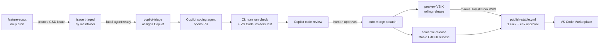

# Agentic feature pipeline

End-to-end automation for discovering, implementing, validating and shipping
features, built on [GitHub Agentic Workflows](https://github.github.com/gh-aw/)
(`gh aw`), the Copilot coding agent and Copilot code review. Every step that
can break a user's VS Code keeps a human gate.



## Components

| Piece | File | Trigger |
| --- | --- | --- |
| Feature discovery agent | `.github/workflows/feature-scout.md` | Daily (fuzzy) + manual |
| Copilot hand-off agent | `.github/workflows/copilot-triage.md` | Issue labeled `agent:ready` |
| Dependency updates | Renovate (`renovate.json`) + npm `min-release-age` (`.npmrc`) | Cooldown-gated, see below |
| Advisory gate on PRs | `.github/workflows/dependency-review.yml` | Every pull request |
| Preview channel | `.github/workflows/release.yml` (`preview` job) | Every merge to `main` |
| Stable promotion | `.github/workflows/publish-stable.yml` | Manual dispatch + environment approval |

- `feature-scout` scans merged PRs and open issues/PRs from the last 7 days
  and files **up to 3** new issues per run in the GSD format, deduplicating
  against **open PRs** so parallel work streams (e.g. provider UI + NaN
  builder endpoints) are never double-filed. It never labels issues
  `agent:ready`; that stays a human decision.
- `copilot-triage` validates a `agent:ready` issue (labels + acceptance
  criteria) and assigns the Copilot coding agent, which opens a linked PR in
  the cloud and reacts to review comments.
- CI is the "does it break VS Code" gate: `npm run check` compiles, runs unit
  tests and launches a real VS Code Insiders integration host
  (`scripts/run-insiders-integration.cjs`), and `npm run package` proves the
  VSIX builds.

## Dependency updates & supply chain

Renovate (Mend app, `app/renovate`) is the single version-update bot for npm
and GitHub Actions. `.github/dependabot.yml` was removed to avoid two bots
filing competing bump PRs. Three layers keep brand-new (possibly malicious)
releases out of the codebase:

1. **Renovate cooldowns** (`renovate.json`, via `security:minimumReleaseAgeNpm`
   + rules): update PRs only appear once the release is **3 days** old (patch),
   **7 days** (minor, and GitHub Actions bumps), or **14 days** (major).
   Renovate marks pending updates with a "pending" status check instead of
   opening the PR early.
2. **npm install guard** (`.npmrc` `min-release-age=3`): even for manual
   `npm install` / lockfile refreshes — including transitive dependencies
   Renovate can't see — npm refuses versions younger than 3 days. `npm ci`
   (CI) installs the vetted lockfile unchanged, so builds never break.
   One-off exceptions: `npm config set min-release-age-exclude '["pkg"]'`.
   Requires npm >= 11.10 (Node 26 bundles 11.20; older npm ignores the key).
3. **Advisory gate** (`.github/workflows/dependency-review.yml`): every PR is
   diffed against `main` and fails if it *introduces* a package version with a
   known GitHub Advisory (severity >= moderate). The pre-existing audit
   baseline stays non-blocking per [`DEPENDENCY-AUDIT.md`](DEPENDENCY-AUDIT.md).

**Security fast lane (no delay):** Renovate's `:enableVulnerabilityAlerts`
(from `config:recommended`) raises fix PRs as soon as an advisory exists —
the cooldown explicitly does not apply to `vulnerabilityAlert` updates. For
transitive-only advisories you can additionally enable *Dependabot security
updates* in *Settings → Code security*; unlike version updates these open
immediately and don't conflict with Renovate.

**Nothing auto-merges today:** Renovate's `automerge` is off in
`config:recommended`, so every bump PR still needs the normal CI gauntlet
(`npm run check` with the VS Code Insiders smoke test + dependency review) and
your approval. If you later want low-risk churn removed, set
`"automerge": true` + `"automergeType": "branch"` for patch/minor in a
`packageRule` — the cooldowns and the advisory gate are what make that safe.

## One-time repository setup (owner only)

1. **Install the CLI** (maintainers editing workflows):
   `gh extension install github/gh-aw`
2. **Create the queue label:**
   ```powershell
   gh label create agent:ready --repo svg153/nan-vscode `
     --color "0E8A16" --description "Approved for Copilot coding agent implementation"
   ```
3. **Enable Copilot agents** in repo *Settings → Copilot → Agent workflows*:
   - Coding agent: allow repository access, "Allow access by agents" enabled.
   - Code review: enable for this repository.
4. **Branch protection on `main`** (*Settings → Branches* or rulesets):
   - Require a pull request before merging.
   - Require status checks: `test` (CI) — this includes the Insiders smoke
     test — and the Conventional Commit lint.
   - Require review from a code owner or at least 1 approving review.
     Do **not** bypass stale approvals when new commits are pushed; the
     coding agent addresses Copilot review comments automatically.
5. **Allow auto-merge**: *Settings → General → Pull Requests → Allow auto-merge*
   and *merge queue*. With it, once you approve, the agent-merge flow fixes
   any CI flake/conflict and squash-merges unattended.
6. **Environments and secrets** (*Settings → Environments*):
   - `marketplace` environment: add your user under **Required reviewers**,
     and store the `VSCE_PAT` secret there (scoped to the `svg153`
     publisher).
   - `COPILOT_GITHUB_TOKEN` is **required**: both compiled agentic locks
     validate it during activation and use it for Copilot inference, so
     without it even feature discovery fails (it is not just an optional
     assignment credential).
   - `GH_AW_AGENT_TOKEN` (the assignment PAT used by `assign-to-agent`) is
     optional: set it only if `gh aw doctor` reports it is needed for your
     plan.
7. **Marketplace variable cleanup**: the old auto-publish flag
   `MARKETPLACE_PUBLISH_ENABLED` is no longer used; delete it if set.
8. **Dependency guards**: add `dependency-review` (and keep `test`) to the
   required status checks on `main`. Optionally enable *Dependabot security
   updates* (Settings → Code security and analysis) for transitive advisory
   fixes; keep *Dependabot version updates* off so Renovate stays the only
   bump bot.

## Daily operation

- **Review discoveries**: `gh issue list --label type:feature` — scout issues
  arrive pre-filled; edit scope if needed.
- **Queue work**: `gh issue edit <n> --add-label agent:ready` → Copilot opens
  the PR on its own. Multiple ready issues run as parallel cloud sessions;
  dedup happens at PR time because each PR must pass required checks.
- **Merge**: approve the Copilot code review, then
  `gh pr merge <n> --auto --squash` (or click *Enable auto-merge*).
- **Validate a build locally**: download the VSIX from the
  [`preview` release](https://github.com/svg153/nan-vscode/releases/tag/preview)
  and install it via *Extensions: Install from VSIX…* (or
  `code --install-extension nan-builders-vscode-preview.vsix`).
  Preview versions sort below the next stable, so the Marketplace update
  channel is never polluted and stable installs still win.
- **Promote to Marketplace** (the simple manual gate):
  1. Check the stable GitHub release produced by semantic-release
      (e.g. `v1.6.0`) works — its VSIX asset is identical to what ships.
   2. *Actions → Publish stable to Marketplace → Run workflow* with that tag.
   3. Approve the pending `marketplace` deployment review. Done.

## Editing agentic workflows

1. Edit the `.md` file under `.github/workflows/` (never the `.lock.yml`).
2. `gh aw compile` and commit both files.
3. `gh aw status` / `gh aw logs feature-scout` for health and run logs.
4. Dry-run a scout without creating issues by commenting nothing and using
   `gh aw run feature-scout` on a test branch, or lower the `max` in
   `safe-outputs.create-issue` while tuning.

## Safety properties

- Issues created by the scout always need a human `agent:ready` label.
- Nothing reaches the Marketplace without: CI + Insiders smoke test passing,
  a human PR approval, a stable GitHub release, and an environment-gated
  manual dispatch (optionally a second reviewer).
- Locked Actions/images pin the compiled workflows (see the `gh-aw-manifest`
  header in each `*.lock.yml`).
