# Agentic feature pipeline

End-to-end automation for discovering, implementing, validating and shipping
features, built on [GitHub Agentic Workflows](https://github.github.com/gh-aw/)
(`gh aw`), the Copilot coding agent and Copilot code review. Every step that
can break a user's VS Code keeps a human gate.

```mermaid
graph LR
  A[feature-scout<br/>daily cron] -->|creates GSD issue| B[Issue triaged<br/>by maintainer]
  B -->|label agent:ready| C[copilot-triage<br/>assigns Copilot]
  C --> D[Copilot coding agent<br/>opens PR]
  D --> E[CI: npm run check<br/>+ VS Code Insiders test]
  E --> F[Copilot code review]
  F -->|human approves| G[auto-merge squash]
  G --> H[semantic-release<br/>stable GitHub release]
  H --> I[preview job<br/>Marketplace pre-release<br/>+ rolling VSIX]
  I --> J[you validate the pre-release<br/>in VS Code]
  J --> K[publish-stable.yml<br/>1 click + env approval]
  K --> L[Marketplace stable]
```



## Components

| Piece | File | Trigger |
| --- | --- | --- |
| Feature discovery agent | `.github/workflows/feature-scout.md` | Daily (fuzzy) + manual |
| Copilot hand-off agent | `.github/workflows/copilot-triage.md` | Issue labeled `agent:ready` |
| Dependency updates | Renovate (`renovate.json`) + npm `min-release-age` (`.npmrc`) | Cooldown-gated, see below |
| Advisory gate on PRs | `.github/workflows/dependency-review.yml` | Every pull request |
| Marketplace pre-release | `.github/workflows/release.yml` (`preview` job) | Every merge to `main` that cuts a release |
| Preview VSIX (rolling) | `.github/workflows/release.yml` (`preview` job) | Same run, attached to the `preview` release |
| Stable promotion | `.github/workflows/publish-stable.yml` | Manual dispatch + environment approval |

- `feature-scout` scans merged PRs and open issues/PRs from the last 7 days
  and files **up to 3** new issues per run in the GSD format, deduplicating
  against **open PRs** so parallel work streams (e.g. provider UI + NaN
  builder endpoints) are never double-filed. It never labels issues
  `agent:ready`; that stays a human decision.
- `copilot-triage` validates a `agent:ready` issue (labels + acceptance
  criteria) and assigns the Copilot coding agent, which opens a linked PR in
  the cloud and reacts to review comments.
- CI is the "does it break VS Code" gate: `npm run check` compiles, runs unit
  tests and launches a real VS Code Insiders integration host
  (`scripts/run-insiders-integration.cjs`), and `npm run package` proves the
  VSIX builds.

## Release channels and versioning

`semantic-release` owns the version. It does not commit version bumps, so
`package.json` in the repository always lags the last tag.

| Channel | Version | How a user gets it |
| --- | --- | --- |
| Stable | `v1.12.0` (the release tag) | Normal Marketplace install/update |
| Pre-release | `1.12.1000` (tag + 1000 patches) | *Switch to Pre-Release Version*, or the `preview` release VSIX |

The Marketplace **does not accept semver prerelease tags** (`1.12.1-preview.3`
is rejected), which is why the preview channel publishes a plain numeric version
instead of a suffixed one; `scripts/marketplace-version.cjs` derives it from the
tag. It also requires pre-release and regular versions to **differ**, so the
preview lane sits 1000 patches above the tag (`PREVIEW_PATCH_OFFSET`): the
preview of `v1.12.0` is `1.12.1000` and the preview of `v1.12.1` is
`1.12.1001`.

Publishing "tag + 1 patch" would be wrong: the preview of `v1.12.0` (`1.12.1`)
and the stable build of the next fix release (`1.12.1`) would be the same
number, and `vsce publish --skip-duplicate` compares version and target — not
channel — so the validated stable artifact would be skipped as a duplicate. The
offset keeps the lanes disjoint and monotonic (`1.12.1001 < 1.13.1000`), the
same shape as the Marketplace's own even/odd-minor recommendation. Because the
pre-release is numerically higher, pre-release users are never silently
downgraded when a stable version ships, and they keep getting previews until
they switch back. Publishing `1.12.0` as stable while `1.12.1000` exists as a
pre-release is explicitly allowed by the Marketplace.

## Dependency updates & supply chain

Renovate (Mend app, `app/renovate`) is the single version-update bot for npm
and GitHub Actions. `.github/dependabot.yml` was removed to avoid two bots
filing competing bump PRs. Three layers keep brand-new (possibly malicious)
releases out of the codebase:

1. **Renovate cooldowns** (`renovate.json`, via `security:minimumReleaseAgeNpm`
   + rules): update PRs only appear once the release is **3 days** old (patch),
   **7 days** (minor, and GitHub Actions bumps), or **14 days** (major).
   Renovate marks pending updates with a "pending" status check instead of
   opening the PR early.
2. **npm install guard** (`.npmrc` `min-release-age=3`): even for manual
   `npm install` / lockfile refreshes — including transitive dependencies
   Renovate can't see — npm refuses versions younger than 3 days. `npm ci`
   (CI) installs the vetted lockfile unchanged, so builds never break.
   One-off exceptions: `npm config set min-release-age-exclude '["pkg"]'`.
   Requires npm >= 11.10 (Node 26 bundles 11.20; older npm ignores the key).
3. **Advisory gate** (`.github/workflows/dependency-review.yml`): every PR is
   diffed against `main` and fails if it *introduces* a package version with a
   known GitHub Advisory (severity >= moderate). The pre-existing audit
   baseline stays non-blocking per [`DEPENDENCY-AUDIT.md`](DEPENDENCY-AUDIT.md).

**Security fast lane (no delay):** Renovate's `:enableVulnerabilityAlerts`
(from `config:recommended`) raises fix PRs as soon as an advisory exists —
the cooldown explicitly does not apply to `vulnerabilityAlert` updates. For
transitive-only advisories you can additionally enable *Dependabot security
updates* in *Settings → Code security*; unlike version updates these open
immediately and don't conflict with Renovate.

**Nothing auto-merges today:** Renovate's `automerge` is off in
`config:recommended`, so every bump PR still needs the normal CI gauntlet
(`npm run check` with the VS Code Insiders smoke test + dependency review) and
your approval. If you later want low-risk churn removed, set
`"automerge": true` + `"automergeType": "branch"` for patch/minor in a
`packageRule` — the cooldowns and the advisory gate are what make that safe.

## One-time repository setup (owner only)

1. **Install the CLI** (maintainers editing workflows):
   `gh extension install github/gh-aw`
2. **Create the queue label:**
   ```powershell
   gh label create agent:ready --repo svg153/nan-vscode `
     --color "0E8A16" --description "Approved for Copilot coding agent implementation"
   ```
3. **Enable Copilot agents** in repo *Settings → Copilot → Agent workflows*:
   - Coding agent: allow repository access, "Allow access by agents" enabled.
   - Code review: enable for this repository.
4. **Branch protection on `main`** (*Settings → Branches* or rulesets):
   - Require a pull request before merging.
   - Require status checks: `test` (CI) — this includes the Insiders smoke
     test — and the Conventional Commit lint.
   - Require review from a code owner or at least 1 approving review.
     Do **not** bypass stale approvals when new commits are pushed; the
     coding agent addresses Copilot review comments automatically.
5. **Allow auto-merge**: *Settings → General → Pull Requests → Allow auto-merge*
   and *merge queue*. With it, once you approve, the agent-merge flow fixes
   any CI flake/conflict and squash-merges unattended.
6. **Marketplace credentials** (*Settings → Secrets and variables → Actions*):
   - Until at least one method below exists, the pre-release job **skips**
     publishing with a warning annotation and a job-summary note instead of
     failing; the rolling `preview` release still carries the VSIX.
   - `VSCE_PAT` at **repository** level (not only inside an environment): the
     pre-release publish runs unattended on every merge and cannot wait for a
     deployment approval. Scope the token to the `svg153` publisher.
   - **Preferred: trusted publishing (OIDC).** Azure DevOps global PATs are
     retired on 2026-12-01. In the
     [publisher management portal](https://marketplace.visualstudio.com/manage)
     → *Trusted publishing*, add one policy per publishing workflow:

     | Workflow | Environment |
     | --- | --- |
     | `.github/workflows/release.yml` (pre-release) | *(leave empty)* |
     | `.github/workflows/publish-stable.yml` (stable) | `marketplace` |

     Then set the repository variable `MARKETPLACE_TRUSTED_PUBLISHING=true`.
     Both workflows authenticate with `vsce publish --oidc` (a 15-minute
     credential, no PAT) and `VSCE_PAT` can be deleted.
7. **Environments** (*Settings → Environments*):
   - `marketplace`: **create it explicitly and add your user under Required
     reviewers.** GitHub silently auto-creates an unprotected environment the
     first time a workflow references a missing one, which would remove the
     approval gate entirely — so create it *before* the first promotion. That
     review is the manual gate for *stable* publishing; the pre-release
     channel is automatic and does not use an environment.
   - `COPILOT_GITHUB_TOKEN` is **required**: both compiled agentic locks
     validate it during activation and use it for Copilot inference, so
     without it even feature discovery fails (it is not just an optional
     assignment credential).
   - `GH_AW_AGENT_TOKEN` (the assignment PAT used by `assign-to-agent`) is
     optional: set it only if `gh aw doctor` reports it is needed for your
     plan.
8. **Dependency guards**: add `dependency-review` (and keep `test`) to the
   required status checks on `main`. Optionally enable *Dependabot security
   updates* (Settings → Code security and analysis) for transitive advisory
   fixes; keep *Dependabot version updates* off so Renovate stays the only
   bump bot.

## Daily operation

- **Review discoveries**: `gh issue list --label type:feature` — scout issues
  arrive pre-filled; edit scope if needed.
- **Queue work**: `gh issue edit <n> --add-label agent:ready` → Copilot opens
  the PR on its own. Multiple ready issues run as parallel cloud sessions;
  dedup happens at PR time because each PR must pass required checks.
- **Merge**: approve the Copilot code review, then
  `gh pr merge <n> --auto --squash` (or click *Enable auto-merge*).
- **Validate a build**: the merge publishes the pre-release to the
  Marketplace once credentials are configured (before that, the job warns and
  skips). Either way you can enable *Switch to Pre-Release Version*
  for the extension and update normally. To test the exact artifact without
  changing your channel, download the VSIX from the
  [`preview` release](https://github.com/svg153/nan-vscode/releases/tag/preview)
  and use *Extensions: Install from VSIX…* (or
  `code --install-extension nan-builders-vscode-preview.vsix`).
- **Promote to Marketplace** (the manual gate, one click after validation):
  1. Confirm the pre-release (or the stable release VSIX) behaves.
  2. *Actions → Publish stable to Marketplace → Run workflow*. Leave the tag
     empty to promote the latest stable release, or pass one (e.g. `v1.12.0`)
     to promote an older one.
  3. Approve the pending `marketplace` deployment review. That approval is the
     "validated" signal; the VSIX published is the one `main` built.
  The release is resolved and pinned *before* the approval gate (the `resolve`
  job has no environment), so the deployment shows the exact tag it will
  publish: a release published while the approval is pending can never be
  promoted by mistake.
  The stable version is the release tag (`1.12.0`), not the pre-release version
  (`1.12.1000`), which is what keeps pre-release users on pre-releases.

## Editing agentic workflows

1. Edit the `.md` file under `.github/workflows/` (never the `.lock.yml`).
2. `gh aw compile` and commit both files.
3. `gh aw status` / `gh aw logs feature-scout` for health and run logs.
4. Dry-run a scout without creating issues by commenting nothing and using
   `gh aw run feature-scout` on a test branch, or lower the `max` in
   `safe-outputs.create-issue` while tuning.

## Safety properties

- Issues created by the scout always need a human `agent:ready` label.
- Nothing reaches the Marketplace **stable** channel without: CI + Insiders
  smoke test passing, a human PR approval, a stable GitHub release, and an
  environment-gated manual dispatch (optionally a second reviewer).
- The pre-release channel is automatic, but it can never publish a stable
  version: `vsce publish --pre-release` only updates the pre-release channel,
  and promoting needs the separate, environment-gated workflow.
- Locked Actions/images pin the compiled workflows (see the `gh-aw-manifest`
  header in each `*.lock.yml`).
